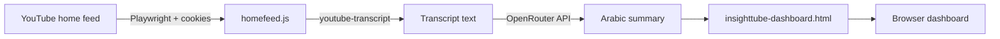

# InsightTube

InsightTube reads your **YouTube home feed**, fetches video transcripts when available, summarizes each video **in Arabic** with an AI model, and writes the results into a local **RTL dashboard** you can open in the browser.

The pipeline is fully local: scraping runs in Playwright, summaries are requested over the API, and the dashboard is a static HTML page updated after each run.

---

## How it works



1. **Scrape** — Chromium opens YouTube with your saved session/cookies and collects titles, URLs, and channel names from the home page.
2. **Transcribe** — For each video ID, the script tries to load captions via `youtube-transcript`.
3. **Summarize** — If a transcript exists, OpenRouter (`nvidia/nemotron-3-super-120b-a12b:free`) produces an Arabic summary.
4. **Publish** — Results replace the `DATA` array inside `insighttube-dashboard.html`.
5. **View** — Open the HTML file in a browser to browse stats, summaries, thumbnails, and inline YouTube previews.

---

## Project structure

| File / folder | Purpose |
|---------------|---------|
| `homefeed.js` | Main script: scrape feed → transcripts → summaries → update dashboard |
| `insighttube-dashboard.html` | Arabic RTL UI; holds `DATA` and client-side rendering logic |
| `insighttube-dashboard.css` | Dashboard styles (dark theme, cards, video preview, responsive layout) |
| `logo.png` | Favicon / app icon for the dashboard tab |
| `.env` | API keys and config (not committed; create from `.env.example`) |
| `.env.example` | Template for required environment variables |
| `cookies.json` | YouTube cookies exported from your browser for authenticated feed access |
| `youtube-session/` | Playwright persistent browser profile (created at runtime; gitignored) |
| `package.json` | Node dependencies and npm scripts |

---

## Requirements

- **Node.js** 18+ (recommended)
- **npm**
- A **YouTube account** (logged-in home feed)
- API keys:
  - **OpenRouter** — used for summarization (`OPENROUTER_API_KEY`)
  - **Google Gemini** — configured in code (`GEMINI_API_KEY`); required at startup even though summarization currently uses OpenRouter

---

## Setup

### 1. Clone and install dependencies

```bash
cd insighttube
npm install
npx playwright install chromium
```

### 2. Environment variables

Copy the example file and fill in your keys:

```bash
cp .env.example .env
```

Edit `.env`:

```env
GEMINI_API_KEY=your_gemini_api_key
OPENROUTER_API_KEY=your_openrouter_api_key
OPENROUTER_BASE_URL=https://openrouter.ai/api/v1
```

| Variable | Description |
|----------|-------------|
| `GEMINI_API_KEY` | Google AI / Gemini API key |
| `OPENROUTER_API_KEY` | OpenRouter API key ([openrouter.ai](https://openrouter.ai/)) |
| `OPENROUTER_BASE_URL` | Optional; defaults to `https://openrouter.ai/api/v1` |

### 3. YouTube cookies

On the first run, Playwright will prompt Google Account login, upon creating the process, a `cookies.json` file will be created that will be reused for future uses.

I have no idea if it invalidates overtime :/

It probably does.

> **Security:** Do not commit `cookies.json` or `.env` to public repositories. Add `cookies.json` to `.gitignore` if you use git.

### 4. (Optional) First-time browser session

`homefeed.js` uses a persistent context at `./youtube-session`. On first run a Chromium window opens (`headless: false`). You can sign in manually if cookies alone are not enough; the session is reused on later runs.

---

## How to run

### Run the full pipeline

```bash
npm start
```

Or:

```bash
node homefeed.js
```

What happens:

1. Chromium opens YouTube and applies `cookies.json`.
2. After a short wait, home-feed videos are collected.
3. Each video is processed: transcript → summary (when possible).
4. Progress is printed in the terminal.
5. `insighttube-dashboard.html` is updated with a new `DATA` array.

### Open the dashboard

After the script finishes:

```bash
# Option A: open the file directly
xdg-open insighttube-dashboard.html   # Linux
open insighttube-dashboard.html       # macOS
start insighttube-dashboard.html      # Windows

# Option B: local static server (optional)
npx serve .
# then visit http://localhost:3000/insighttube-dashboard.html
```

Keep `insighttube-dashboard.css` and `loho.png` in the same folder as the HTML file so styles and the tab icon load correctly.

---

## Dashboard features

- **Stats bar** — total videos, with/without transcript, unique channels
- **Video cards** — title, channel, transcript badge, Arabic summary
- **Video preview** — thumbnail (`<video poster="…">`); click play to embed YouTube in-page
- **Link** — open the video on YouTube in a new tab
- **RTL layout** — Arabic UI with Tajawal / Space Mono fonts

Filter/search UI exists in the HTML but is commented out by default. `currentFilter` defaults to `'has'` (only videos with transcripts) when filters are disabled.

---

## Output data shape

Each entry written to `DATA` looks like:

```json
{
  "title": "Video title",
  "url": "https://www.youtube.com/watch?v=VIDEO_ID",
  "channel": "Channel name",
  "videoId": "VIDEO_ID",
  "hasTranscript": true,
  "summary": "Arabic summary text…"
}
```

If no transcript is available, `hasTranscript` is `false` and `summary` is `"لا يوجد transcript متاح"`.

---

## Dependencies

| Package | Role |
|---------|------|
| [playwright](https://playwright.dev/) | Browser automation for YouTube scraping |
| [youtube-transcript](https://www.npmjs.com/package/youtube-transcript) | Fetch video captions by ID |
| [openai](https://www.npmjs.com/package/openai) | OpenRouter-compatible client for summarization |
| [@google/generative-ai](https://www.npmjs.com/package/@google/generative-ai) | Gemini SDK (initialized; summarization uses OpenRouter) |
| [dotenv](https://www.npmjs.com/package/dotenv) | Load `.env` variables |

---

## Troubleshooting

| Issue | Things to try |
|-------|----------------|
| `GEMINI_API_KEY` / `OPENROUTER_API_KEY` error | Create `.env` from `.env.example` and set both keys |
| Empty or wrong home feed | Refresh `cookies.json`; sign in via the Playwright window |
| No transcripts | Captions may be disabled or unavailable for that video |
| OpenRouter errors | Check API key, quota, and model name in `summarize()` |
| Dashboard empty | Run `homefeed.js` first; confirm `DATA` is not `[]` in the HTML |
| Styles missing | Open HTML from the project folder so `insighttube-dashboard.css` resolves |

---

## License

ISC (see `package.json`).
